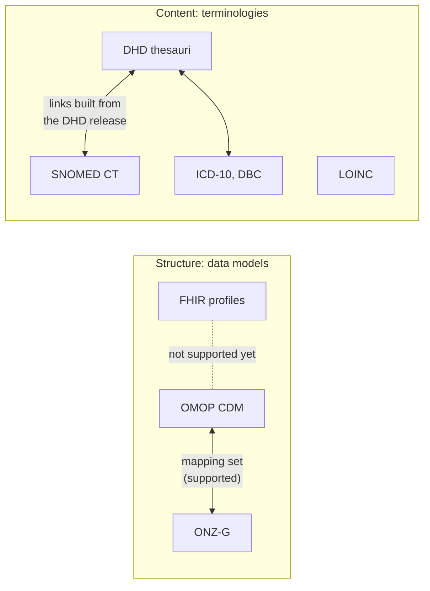

# From Your Standard to Rosetta

Rosetta maps data and codes between healthcare standards such as OMOP, FHIR, the DHD thesauri, and SNOMED CT.
This page explains what Rosetta does with each of them.

## Structure and content

A standard describes either structure or content.
A data model such as OMOP CDM or ONZ-G is an **ontology source** in Rosetta, and a terminology such as SNOMED CT or the DHD thesauri is a **vocabulary source**.
A **mapping set** links concepts from two standards.

## Your standard in Rosetta

| You know it as | What it is | In Rosetta | What you can do today |
| --- | --- | --- | --- |
| OMOP Common Data Model | The tables and fields of the OMOP database, such as Person, Visit Occurrence, and Condition Occurrence | Ontology source `omop-cdm`, an OWL rendering of CDM 5.4 | Use its tables as the subject or object of a mapping set, and check that every reference exists |
| OMOP Standardized Vocabularies (Athena) | The OMOP concept table with codes from SNOMED CT, LOINC, RxNorm, ICD-10, and others | Vocabulary source `omop`, format `athena` | Ingest an Athena download and build a graph that links each OMOP concept to its original code, for SNOMED, LOINC, RxNorm, RxNorm Extension, ICD10, and ICD10CM only; concepts from other vocabularies are left out |
| ONZ-G | An ontology published on the KIK-V platform, with concepts such as client, caregiver, and care organisation | Ontology source `onz-g` | Map OMOP CDM to it, as the `omop-onz-g` mapping set does |
| DHD Diagnosethesaurus (DT) | The Dutch hospital list of diagnoses, with links to SNOMED CT, ICD-10, and DBC | Vocabulary source `dhd-thesauri`, format `dhd-csv` | Build a graph of the diagnoses valid on a chosen date, with those links |
| DHD Verrichtingenthesaurus (VT) | The Dutch hospital list of procedures, with links to SNOMED CT | Vocabulary source `dhd-thesauri`, format `dhd-csv` | Build a graph of the procedures valid on a chosen date, with their SNOMED CT links |
| SNOMED CT | The clinical terminology | Vocabulary source `snomed-international`, format `rf2` | Build a graph with active concepts, preferred terms, synonyms, and the is-a hierarchy |
| LOINC | The terminology for lab tests and observations | Vocabulary source `loinc-snomed`, format `rf2` | Build the LOINC-SNOMED Ontology as a graph |
| ICD-10 and DBC | Classification and billing codes | No source of their own | They appear as link targets in the OMOP and DHD graphs |
| FHIR profiles, ValueSets, and ConceptMaps (for example on Simplifier) | Structure and terminology bindings for exchange | Not supported | Nothing yet, see [FHIR](#fhir) |

## FHIR

Rosetta does not read or write FHIR today.
A FHIR ConceptMap is close to a mapping set, and a CodeSystem is close to a vocabulary source.

## What Rosetta produces

| You want to | Rosetta gives you | Format |
| --- | --- | --- |
| Share mappings with other teams and tools | The mapping set with its metadata, author, confidence, and justification per row | SSSOM/TSV |
| Load mappings into a triple store or query them | One triple per mapping | RDF/Turtle |
| Review a mapping set | A summary with the mapping count and counts per predicate; run `mapping validate` for the validation issues | Markdown and HTML |
| Query or browse a terminology | The terminology as a SKOS graph, with provenance | RDF/Turtle and JSON |
| See what changed between two releases | A list of added and removed rows, mappings, or triples | JSON |

All outputs are open formats that other tools can read without Rosetta.

## Next steps

- [Background](index.md) shows how the components fit together.
- [Onboarding a Standard and Mapping](../guides/onboarding.md) shows how to add your own standard.
