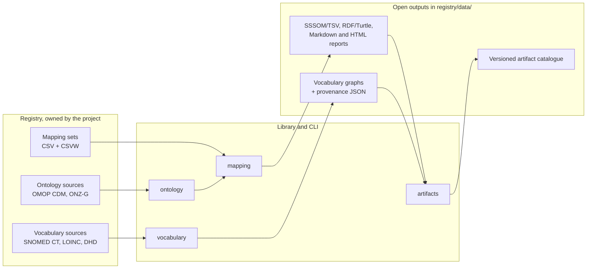

# Background

Rosetta reads hand-written mappings and licensed terminology releases from a registry and writes open files.
Each library feature has a matching group of CLI commands, as decided in [ADR-0002](../decisions/0002-organize-the-library-around-public-feature-apis.md).

Validation never downloads anything, and a build writes no file when validation finds an error.

| Page | Description |
| --- | --- |
| [From Your Standard to Rosetta](from-standard-to-rosetta.md) | What Rosetta does with OMOP, ONZ-G, the DHD thesauri, SNOMED CT, LOINC, and FHIR. |
| [Registry](registry.md) | What belongs in a registry and what belongs in the library. |
