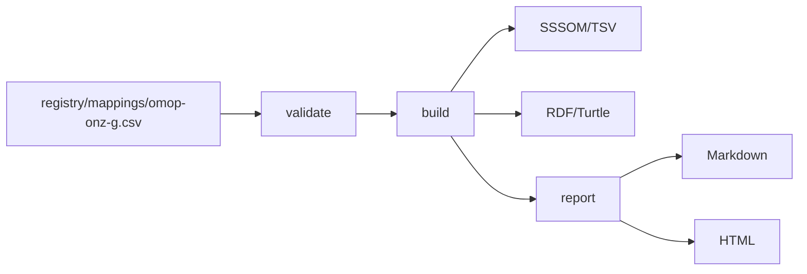
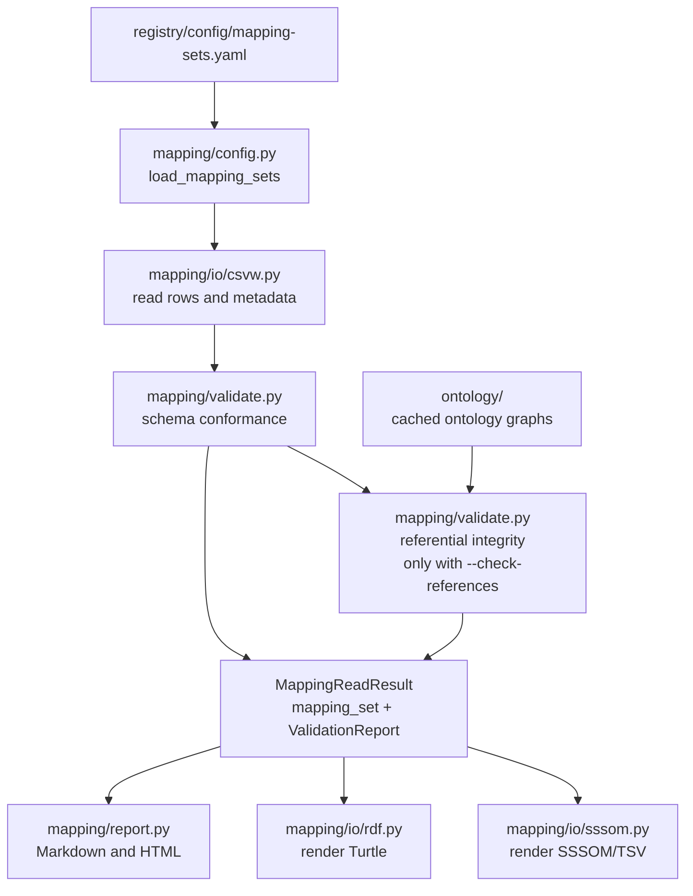

# Quickstart

This guide builds the tracked `omop-onz-g` mapping set into open artifacts and shows where the result ends up.
It reproduces the `sssom-rosetta` workflow on top of `plugin-rosetta`.



## Requirements

You need Python 3.14, [uv](https://docs.astral.sh/uv/) and [just](https://just.systems/).

```shell
uv sync --group dev
```

## Run it offline

```shell
just quickstart
```

The recipe validates the mapping set, builds it and writes the report.
It needs no network access and no licensed data.
The output goes to `registry/data/mappings/omop-onz-g/`:

| File | Content |
| --- | --- |
| `omop-onz-g.sssom.tsv` | Mappings and metadata in SSSOM/TSV |
| `omop-onz-g.ttl` | The same mappings as RDF/Turtle |
| `omop-onz-g.md` | Validation and mapping report in Markdown |
| `omop-onz-g.html` | The same report as a standalone page |

Open the HTML file in a browser to read the report.
The warnings about empty `reviewer_id` cells are expected for the current data.
They report that an empty cell was read as an absent value.

## What you see

The tracked mapping set links 8 OMOP CDM tables to concepts in the ONZ-G ontology.

The SSSOM/TSV file starts with metadata lines that begin with `#`, followed by one row per mapping.
The metadata holds the mapping set id, the license and the `curie_map` that expands prefixes such as `omop:` and `onz-g:` to full IRIs.

| Column | Meaning |
| --- | --- |
| `subject_id`, `object_id` | The two concepts that are linked, written as CURIEs |
| `predicate_id` | The kind of link, taken from SKOS |
| `mapping_justification` | How the mapping was made, here `semapv:ManualMappingCuration` for every row |
| `confidence` | A number from 0 to 1 that expresses how sure the curator is that the mapping is correct |
| `author_id`, `author_label` | Who asserted the mapping |
| `comment` | The reasoning behind the chosen predicate |

The predicate tells you how the two concepts relate.
`exactMatch` means the concepts are equivalent.
`broadMatch` means the object is broader than the subject, so `omop:Provider` is narrower than `onz-g:Caregiver`.
`narrowMatch` is the reverse and `relatedMatch` links concepts that are associated without one containing the other.

The confidence values are manual estimates that were carried over from `sssom-rosetta`.
No scale is recorded for them, so read them as the curator's relative judgement and not as a measured score.
The `reviewer_id` column is empty for all rows, which means no independent reviewer has confirmed them yet.
Issue #23 tracks the decision on these values.

The Turtle file contains one triple per mapping, for example `omop:Person skos:exactMatch onz-g:PatientInCare`.
It does not carry the confidence, justification or comment, so use the SSSOM file when you need those.

The report summarises the set.
It lists the number of mappings and a table with the count per predicate.
The lines `Added`, `Removed` and `Changed` compare against a previous version, so on a first build every mapping counts as added.

## Check references against the ontologies

```shell
just quickstart-full
```

This recipe first downloads and caches the `omop-cdm` and `onz-g` ontologies, then validates and builds with `--check-references`.
Every `subject_id` and `object_id` is then resolved against the ontology bound to it in `registry/config/mapping-sets.yaml`.
It needs network access and takes longer.
The download warns that no checksum is pinned for `omop-cdm` and `onz-g`.
That warning is expected until the checksums are recorded in issue #22, and it prints the computed SHA-256 for reference.
Later runs reuse the cache unless you run `uv run rosetta ontology fetch <name> --force`.

## How the package works

Everything starts from configuration.
The CLI and the Python API both take a mapping-set key such as `omop-onz-g` and resolve it through `registry/config/mapping-sets.yaml`.
That file points at the authored CSV and its CSVW metadata, and it holds the `mapping_set_id`, the license, the `curie_map` and the ontologies bound to the subject and object side.



`read_mapping_set` in `mapping/api.py` is the single entry point that reads and validates.
`build_mapping_artifacts` and `report_mapping_set` call it too, so the CLI and your own code follow the same path.
The CLI is a thin layer over these functions, and these calls do what `just quickstart` does:

```python
from pathlib import Path

from plugin_rosetta.mapping import build_mapping_artifacts, read_mapping_set, report_mapping_set

result = read_mapping_set("omop-onz-g")
print(len(result.mapping_set.mappings), "mappings,", len(result.report.issues), "warnings")

output_dir = Path("registry/data/mappings/omop-onz-g")
sssom_path, turtle_path = build_mapping_artifacts("omop-onz-g", output_dir=output_dir)
markdown_path, html_path = report_mapping_set("omop-onz-g", output_dir=output_dir)
```

The package layout and the split between library and content are described in ADR-0002 and ADR-0003.
The README covers the `ontology`, `vocabulary` and `artifact` commands.

## Explore interactively

```shell
just notebook
```

The marimo notebook `notebooks/quickstart_nb.py` reads the mapping set, lists the input warnings, shows the mappings as a table and renders the artifacts.
It also builds OMOP, DHD and RF2 vocabulary graphs from the synthetic fixtures in `tests/fixtures/vocabulary/`.
The notebook writes to temporary directories, so it leaves nothing behind.

## Use your own workspace

```shell
uv run rosetta init my-rosetta-workspace
```

This creates an empty workspace with your own catalogues.
The healthcare configuration in the top-level `registry/` is a working example and is not shipped in the package (ADR-0003).

## Where to go next

- `docs/capability-matrix.md` lists what is configurable and what is fixed.
- `registry/README.md` describes the source configuration.
- `docs/decisions/` holds the architecture decisions.
