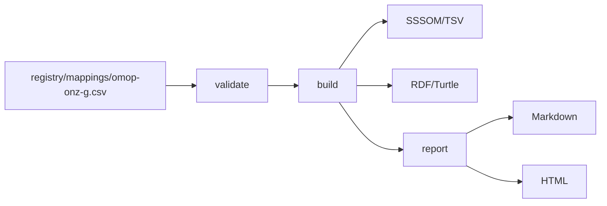

# Quickstart

This guide builds the tracked `omop-onz-g` mapping set into open artifacts and shows where the result ends up.
It reproduces the `sssom-rosetta` workflow on top of `plugin-rosetta`.



## Requirements

You need Python 3.14, [uv](https://docs.astral.sh/uv/) and [just](https://just.systems/).

```shell
uv sync --group dev
```

## Run it offline

```shell
just quickstart
```

The recipe validates the mapping set, builds it and writes the report.
It needs no network access and no licensed data.
The output goes to `registry/data/mappings/omop-onz-g/`:

| File | Content |
| --- | --- |
| `omop-onz-g.sssom.tsv` | Mappings and metadata in SSSOM/TSV |
| `omop-onz-g.ttl` | The same mappings as RDF/Turtle |
| `omop-onz-g.md` | Validation and mapping report in Markdown |
| `omop-onz-g.html` | The same report as a standalone page |

Open the HTML file in a browser to read the report.
The warnings about empty `reviewer_id` cells are expected for the current data.
They report that an empty cell was read as an absent value.

## Check references against the ontologies

```shell
just quickstart-full
```

This recipe first downloads and caches the `omop-cdm` and `onz-g` ontologies, then validates and builds with `--check-references`.
Every `subject_id` and `object_id` is then resolved against the ontology bound to it in `registry/config/mapping-sets.yaml`.
It needs network access and takes longer.
The download warns that no checksum is pinned for `omop-cdm` and `onz-g`.
That warning is expected until the checksums are recorded in issue #22, and it prints the computed SHA-256 for reference.
Later runs reuse the cache unless you run `uv run rosetta ontology fetch <name> --force`.

## Explore interactively

```shell
just notebook
```

The marimo notebook `notebooks/quickstart_nb.py` reads the mapping set, lists the input warnings, shows the mappings as a table and renders the artifacts.
It also builds OMOP, DHD and RF2 vocabulary graphs from the synthetic fixtures in `tests/fixtures/vocabulary/`.
The notebook writes to temporary directories, so it leaves nothing behind.

## Use your own workspace

```shell
uv run rosetta init my-rosetta-workspace
```

This creates an empty workspace with your own catalogues.
The healthcare configuration in the top-level `registry/` is a working example and is not shipped in the package (ADR-0003).

## Where to go next

- `docs/capability-matrix.md` lists what is configurable and what is fixed.
- `registry/README.md` describes the source configuration.
- `docs/decisions/` holds the architecture decisions.
